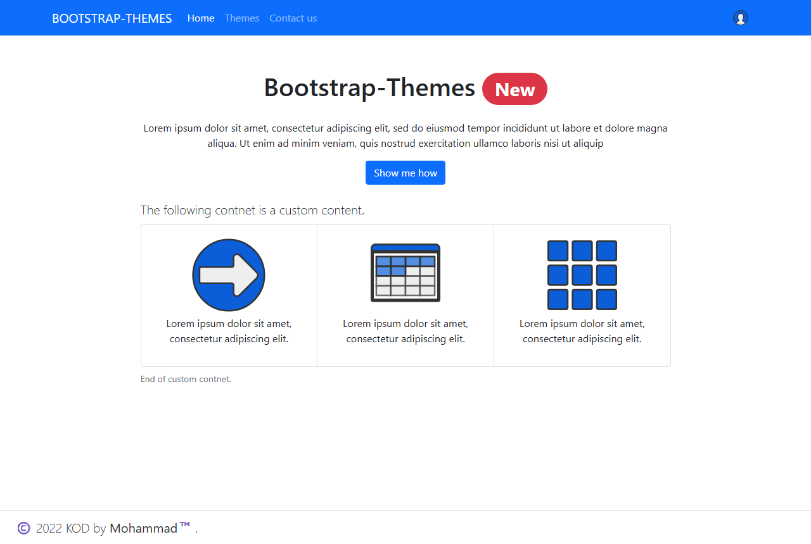
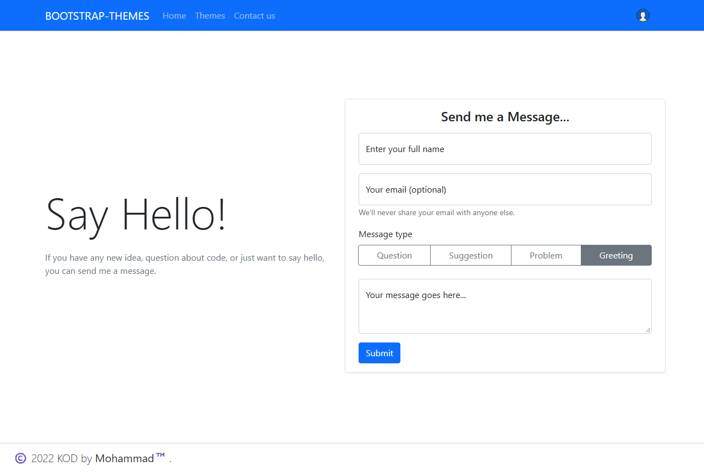

# React-Bootstrap-Theming

A React app that tries out theming Bootstrap 5: a custom theme built from Bootstrap's Sass, new elements (a custom grid, SVG sprite icons, a footer) that take their colours from the theme, and a theme picker in the navbar. Built with Create React App, React Bootstrap and React Router.

**Live demo:** https://mohammad-diab.github.io/React-Bootstrap-Theming/



## Goals

| Goal | Status |
|---|---|
| Add a new element to Bootstrap | Done |
| Customize the Bootstrap theme | Done |
| Customize the new element's theme | Done |
| Support multiple themes | Done |
| Switch between themes without a refresh | Not yet: the page reloads |
| An easy way to add a new theme with minimal changes | Not yet |
| One theme across a multi-page app | Done |
| Icon colours follow the theme | Done |
| Routing | Done |
| Let the user customize the whole website | Not yet |

## Pages

- **Home**: a title, a short text and the custom grid: three items, each with a themed SVG icon.
- **Themes**: the themes as Bootstrap cards with a preview image each.
- **Contact us**: a message form with floating labels and a message type picker (Question, Suggestion, Problem, Greeting). It has no backend.
- **User menu** (navbar): the user card, placeholder Settings, Sign out and language items, the theme picker (Theme A, Theme B) and a Dark theme switch.

The chosen theme and the dark flag are saved in `localStorage`; on load the app adds `themeA` or `themeB` (and `dark`) as classes on `<html>` and loads only the active theme's CSS, and choosing a theme or flipping the Dark theme switch saves it and reloads the page.



## Source

The original repository was lost. The code here was recovered in 2026 from the source maps of the deployed build (January 2022):

- `src` comes straight from the source maps, except `src/themes/themeA/theme.scss`, which was rebuilt from the compiled CSS (it compiles to the same CSS), and the theme work described below.
- `package.json` and `package-lock.json` were rebuilt from the versions in the build: react-scripts 5.0.0, React 17.0.2, React Router 6.2.1, Bootstrap 5.1.3, React Bootstrap 2.0.4 and Sass 1.45.1.
- Theme A was the only theme in the recovered build. Theme A dark, Theme B, Theme B dark and the Dark theme switch were completed in 2026 following the design already in the code: the picker's swatches (`#0b5ed7` for Theme A, a square `#00bfa5` for Theme B), the `themeA`, `themeB` and `dark` classes on `<html>` and the choice saved in `localStorage`. Only the active theme's CSS is loaded, and the four preview images in `public/assets/img` are real screenshots of the themes.

Because of these changes, the CSS and JavaScript built from this repository differ from the deployed build of January 2022.

## Requirements

[Node.js](https://nodejs.org/) with npm. Tested with Node.js 24.

## Building

```
git clone https://github.com/Mohammad-Diab/React-Bootstrap-Theming.git
cd React-Bootstrap-Theming
npm ci
npm start
```

`npm start` runs the development server on http://localhost:3000. `npm run build` writes the production site to `build`. The app uses browser routes (`/themes`, `/contact-us`), so the web server has to answer unknown paths with `index.html`. To serve it under a subpath, build with `PUBLIC_URL` set to that path; the GitHub Pages workflow builds with `PUBLIC_URL=/React-Bootstrap-Theming` and copies `index.html` to `404.html`.

## Author

Mohammad Diab

## License

[MIT](LICENSE)
